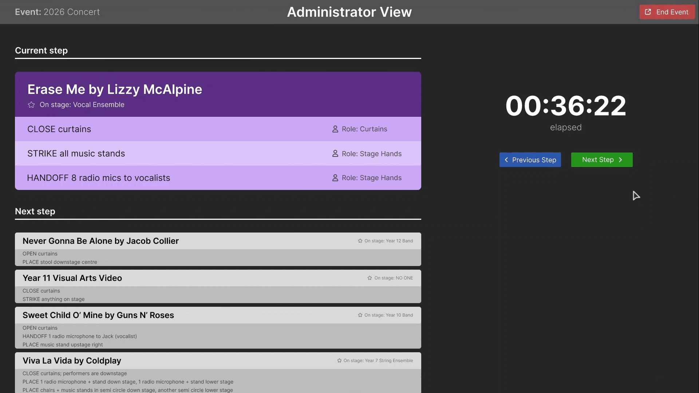
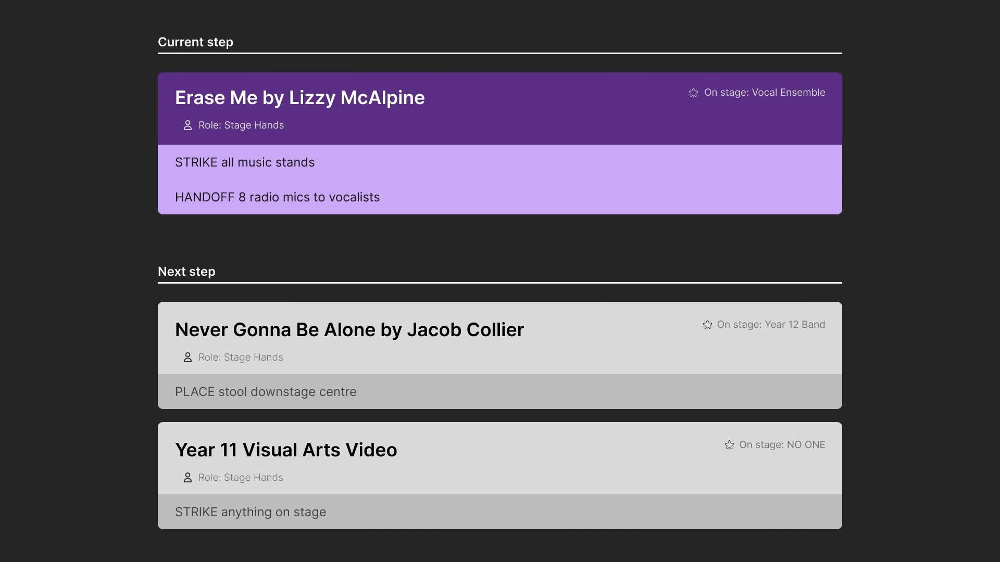

# Digital Backstage/Audio Crew Run Sheet
A small backstage/audio crew at a school organises the neccessary equipment and technical settings needed during events and concerts. They currently use a paper run sheet - a list of instructions and technical specifications for each performance - which is overwhelming and hard to follow.

## Scope and scale
The software will be used by  8-12 crew members concurrently during an event. It will also be used in the preparation leading up to events by 2-3 users.

## Software Functionality
The software provides a digitized and synchronised run sheet, which highlights the current step and updates during an event. Crew members are able to follow along with the event administrator and easily view their instructions, reducing the amount of incorrect or missed instructions.

**Before the event**
- Event administrators can create, edit and delete a run sheet for a specific event

**During the event**

*Event administrators can progress through the run sheet*

*Crew members can view instructions, synchronised with the event admin*