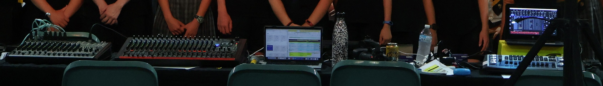
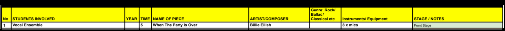
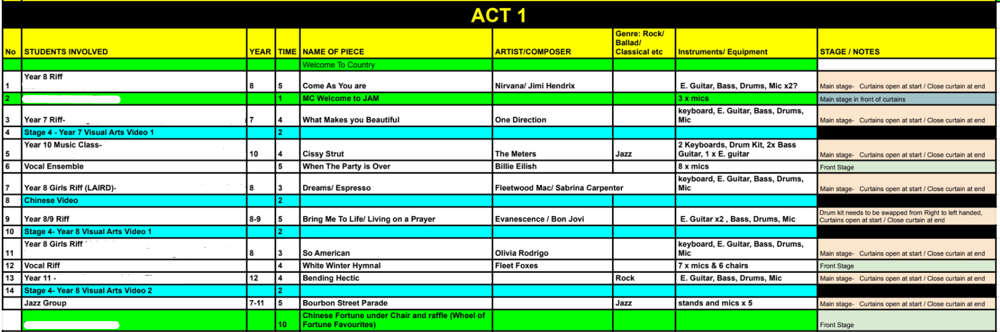

# Scenario Details
This page provides information about the scenario chosen for this project.

*Audio crew main console*

## Context
A small backstage/audio crew at my school struggles to organise the necessary gear and equipment for each performance during a school concert, which takes place in a dark environment. Equipment and props must be put on stage and given to performers with precise timings. 

On average there are 18-20 distinct performances with varying tech configurations and equipment layouts needed. Members follow run sheets - a set of detailed technical instructions telling crew members what to do. Some are printed on paper, some are viewed on a laptop with Google Sheets open.

*Example of one instruction in a run sheet*

## User roles
The audio crew has two roles - event administrators and members. **Event administrators** could be teachers or senior crew members who plan, manage and oversee the event. **Crew members** carry out the tasks assigned to them. The system will involve role based access controls (RBAC). This corresponds to the concept of authorisation - the level of access a user will have.

Members are split into several responsibilities/jobs to seamlessly run the event: backstage hands, curtains, visuals, sound, camera, lighting. Some tasks include lighting changes, microphone handoffs and visual transitions. These responsibilities/jobs dictate which instructions crew members can see.

## Problem
The current run sheets have the following limitations:
- Paper run sheets are hard to read in the dark
- Existing run sheets are hard to follow along. Time is wasted reading and re-reading it
- Existing run sheets contain overwhelming amounts of information
- A mix of digital and paper run sheets means that they are not synchronised, creating confusion

## Current situation
Run sheets are currently created in Google Sheets, then printed off hours before the show. It contains information on: the performance name, the performers, the type of performance, its estimated run time, people on stage and technical requirements. It provides rather vague instructions to crew memebers and they must follow along themselves in the dark, which can be difficult with the limited amount of time and lack of communication between members with different responsibilities due to other limitations.

Also, details are often changed last minute to accomodate for absent performers or equipment failures. This is currently mitigated by displaying the program on Google Sheets, using laptops/desktops placed in key areas. This does not solve the issue that the run sheet contains mostly irrelevant information - a lot of time is spent reading and re-reading the run sheet to ensure the event runs smoothly. By making it simpler to read, members can focus on performing their tasks, reducing hiccups and forgotten equipment.

*Existing run sheet: overwhelming and hard to follow*

## Desired outcome
Ideally, the following improvements should occur:
- Crew members are less confused as to what their responsibilities are, reducing incorrect and forgotten technical steps
- Less time is spent deciphering run sheets, allowing members to focus their efforts into troubleshooting unpredictable issues
- Run sheets are easier to read in the dark, reducing cognitive load

## Assumptions
- Every user has access to the Internet
- Users are proficient in navigating technology