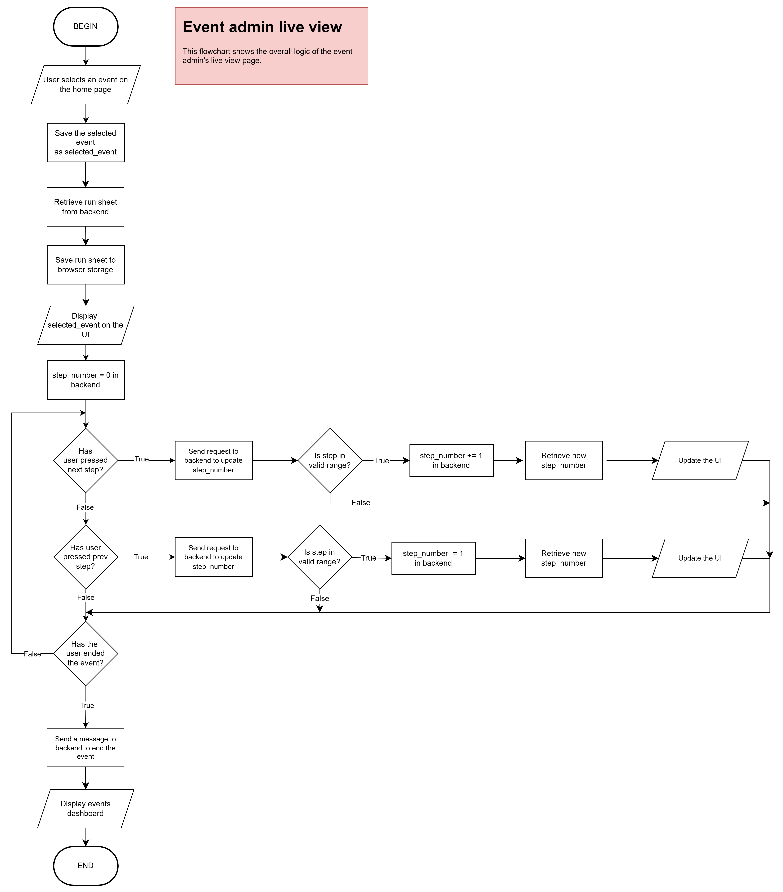
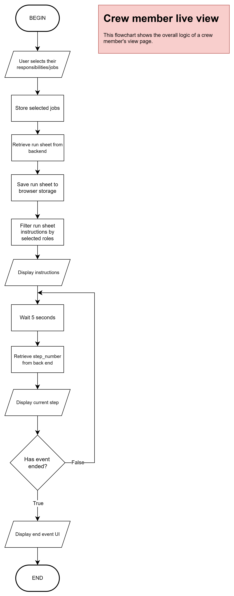

# Flowchart algorithms
This page holds the flowchart algorithms used to describe the overall logic of the live view pages - the page shown when a run sheet is being 'played' in real time. The other pages are not as substantial, and are less crucial to the core logic of the software.

## Event admin live view

## Crew member live view
