# Security within code
This page details how several security features have been embedded into the code and the overall system.

Some strategies used throughout the project to manage and ensure security include:
- Code review tools such as Pylint and Eslint automatically alerts me of deprecated/insecure functions
- Adding SAST to the CI/CD pipeline on GitLab

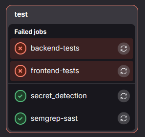

- Using OWASP ZAP DAST tool to identify vulnerabilities

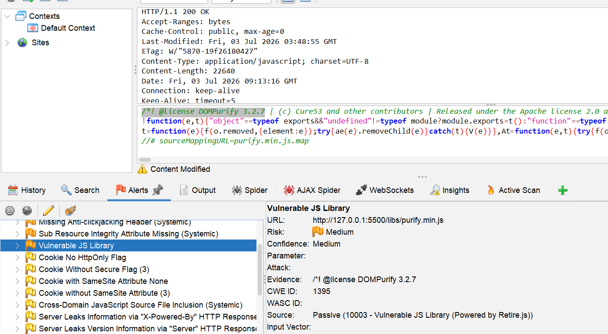

## Input validation, sanitisation and encoding
The first layer of data validation is embedded within the HTML code itself. The input fields use the corresponding input types, which (in the case of the screenshot) automatically restricts users inputs to dates, with a maximum date of 31/12/9999. A date further than this limit would break any code that does date comparisons, for example, the code that sorts events by date.
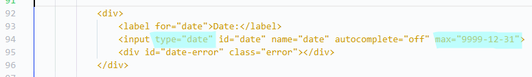

*Function to create the UI for event creation in `frontend/components/dialog.js`*

The second layer of defensive input handling is within JavaScript. The web app uses the DOMPurify library to sanitise user inputs. Inputs containing malicious scripts and HTML tags will be removed from the data. For example, `ABC<script>` will turn into `ABC`. This helps to prevent XSS attacks, since threat actors are unable to input scripts.
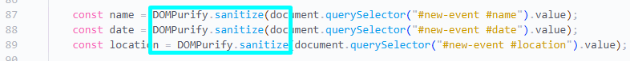

*Sanitising user inputs in `frontend/homepage/homepage.js`*

The JavaScript code also performs its own data validation checks in case the input field has been bypassed. This also helps to prevent unnecessary requests to the server, which could slow down performance.

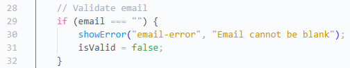

*Data validation in `frontend/index.js`*

If these methods of data sanitisation are bypassed, the backend also performs sanitisation on the data, utilising the external library called Bleach. Malicious tags and characters are removed from user inputs, especially when they can be displayed on the UI later on.
**Note:** Python [Bleach](https://pypi.org/project/bleach/) became deprecated during production, and needs to be updated in the future.

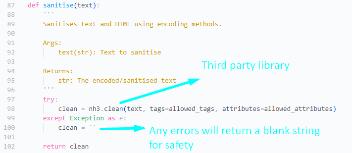

*Function to sanitise user inputs in `backend/app.py`*

Since the backend also uses a SQLite3 database, the database is already defended against SQL injection attacks. The SQLite database inherently validates its inputs[^1]. To facilitate this, all SQL queries use parameters rather than the alternative - concatenating strings without any validation and saving malicious data to the database.

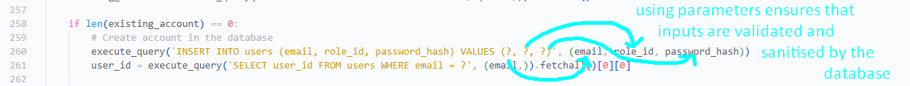

*Use of parameters in `backend/app.py`*

## Session Management
Sessions last two hours in order to prevent unauthorised persons from accessing a user's device and using the same authenticated session to breach data. Two hours is necessary since events often go for quite a long time. A JWT is issued upon the user sucessfully logging in, which is included with every request. This was made with the help of course work in PWP 9 and 10.

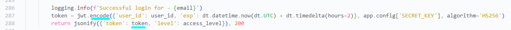

*A token is created and returned in the response in `backend/app.py`*

The token is stored in session storage. It deletes itself whenever the tab is closed. Other websites cannot access the session storage of another website[^2] , which prevents other domains from making requests to the backend using the stored JWT. Thus, it mitigates CSRF attacks.

However, the app fails to identify session logins from multiple locations. This would require several additions to the database and backend, which was not possible due to time constraints.

## Authentication and authorisation mechanisms
An authentication system has been implemented to verify the user's identity and ensure they are authorised to access the system in the first place. It was based off of the authentication system made in the LearnerHours PWA. A secure password policy has been implemented in order to prevent passwords from being too easy to guess. It uses a Regex expression that was made using [this website](https://regex-generator.olafneumann.org/).
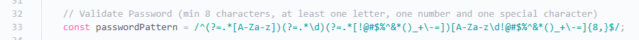
*Code to implement secure password policy in `frontend/authentication/signup.js`*

Passwords are hashed before they are saved in the database using the werkzeug library. They are turned into ciphertext and cannot be read. However, passwords can still be intercepted and read in transit. This is because the website currently uses HTTP.

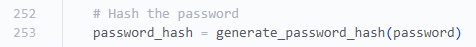

*This third party function in `backend/app.py` uses a hashing algorithm*

Authorisation is also performed, determining what level of access the user has. The website uses role based access, where there are two roles: user and admin. Admins can view a particular set of pages, while users can view a their own set of pages. The function below checks what level of access the user has, and whether they have adequate acccess to data. In summary, the database stores what level of access the user has, and checks it against what they are trying to access. If it matches, they are allowed to access the resource.

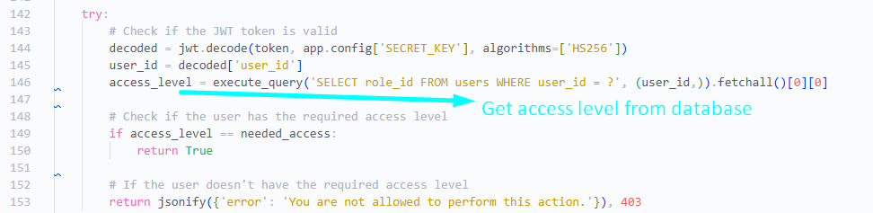
*The access level is saved and checked with every request in `backend/app.py`*

## System Logging
User activities and system usage are logged to a file for later review. This is enabled by the third party `logging` library. Suspicious activity can be detected by system administrators. Things such as failed authentication attempts and event deletions are logged. For example, if the log file shows that there were 12 failed login attempts within the span of a minute, it could indicate that someone is trying to perform a brute force attack.

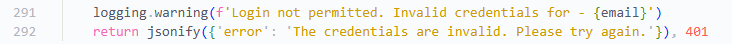
*Events are logged throughout the code, just like in line 291 of `backend/app.py`*

## Rate limiting
Important routes within the backend are rate limited, which prevents brute force attacks and Denial of Service attacks. Rate limiting is made possible using an addon to the Flask library.

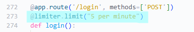

*Rate limiting in `backend/app.py`*

[^1]: *Defense Against The Dark Arts 2026*, Sqlite.org, viewed 4 July 2026, \<https://sqlite.org/security.html>.
[^2]: *Window: sessionStorage property - Web APIs | MDN 2025*, Mozilla.org, viewed 4 July 2026, \<https://developer.mozilla.org/en-US/docs/web/API/Window/sessionStorage>.