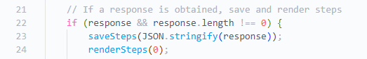
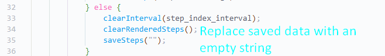

# Code optimisation
It is also worth it to document what code optimisation techniques have been implemented, since they contribute to the overall security of the system.

## Deletion of data when finished
When data is no longer needed, it is immediately deleted. This clears up memory and improves website performance in other pages. It also lowers the chance that third party browser extensions can access the data and send it to unauthorised people, which would be a major privacy breach. 

For example, when crew members are viewing a live event, all the steps are stored in session storage (as per the flowchart).

*Data is saved to session storage in `crew.js`*

If the live event is finished, the data stored in session storage will be wiped via line 35, which replaces all the data with an empty string. This stops the event data from being accessible after the event.

*Data is removed in `crew.js` when an event has finished*