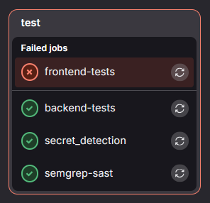

# Deployment
This page outlines the automated deployment strategies that were implemented.

**How was it implemented?**
 
GitLab pipelines were used to automatically run tests whenever a commit was made to the dev branch. The `.gitlab-ci.yml` file drives the automated tests and was written with the help of GitLab documentation and online articles. 

After the pipeline finishes, I a report that details which tests failed and which succeeded. I can also go into the console logs outputted from each test in order to check specifically which test failed.

## SAST Scanning
**Enabled with the help of:** https://docs.gitlab.com/user/application_security/sast/
 
This ensures that there are no major vulnerabilities in the code before I continue on with the project. It scans the codebase for a myriad of common vulnerabilities and alerts me of any. It did not catch out any vulnerabilities in this project. You can view the results of all SAST tests [here](https://gitlab.com/alexander.legia1/se12-project/-/jobs?name=semgrep&kind=BUILD). Only one test failed because I misconfigured the pipeline.

## Secret Detection
**Enabled with the help of:** https://docs.gitlab.com/user/application_security/secret_detection/pipeline/
 
This checks if any API keys or encryption keys have been leaked in my codebase. This can turn out to be a major vulnerability later on, even if the app is not deployed to the public. You can view the results of all secret detection tests [here](https://gitlab.com/alexander.legia1/se12-project/-/jobs?name=secret_detection&kind=BUILD).

## Backend Tests
**Enabled with the help of:** https://medium.com/@morepravin1989/automatically-run-tests-using-github-actions-step-by-step-guide-for-beginners-with-example-51acdd6dd0ea
 
I have written backend tests in `Code/tests/back_test.py`, which execute automatically open each commit. These help to verify that I have not broken any major backend functions during the producing and implementing phase. Many tests failed due to misconfigurations, but some were helpful. For example, when I was migrating to nh3, the authentication tests started to fail, prompting me to migrate back to Bleach. You can view the results of all tests [here](https://gitlab.com/alexander.legia1/se12-project/-/jobs?name=backend&kind=BUILD).

## Frontend Tests
**Enabled with the help of:** https://medium.com/@morepravin1989/automatically-run-tests-using-github-actions-step-by-step-guide-for-beginners-with-example-51acdd6dd0ea
 
I have written frontend tests in `Code/tests/front_unittest.js` in order to verify the functionality of some functions used in the website. Again, many failed due to misconfigurations in the GitLab pipeline. You can view the results of all tests [here](https://gitlab.com/alexander.legia1/se12-project/-/jobs?name=frontend-tests&kind=BUILD).