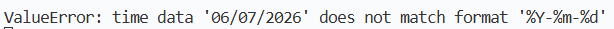

# 3. Test Cases
*Note: some test cases have been collapsed into one test case because the tests are run automatically using a script*

**Test Case ID:** 001

**Feature:** Form validation for event manipulation (specifically, creating an event)

**Test Steps:**
1. Configure pipelines on GitLab
2. Write the code for the unit tests in `front-unittest.js`. Four different inputs will be tested on the `isDateValid()` function:
    1. 2023-03-21
    2. 21023-04-20
    3. 21/08/4023
    4. 21/08/24022
3. Commit the changes to GitLab
4. View test results

**Expected Result:**
 
All tests should pass.

**Actual Result:**
 
The test results were:
1. Pass
2. Fail
3. Fail
4. Pass

**Pass/Fail:**
 
❌ Fail

---

**Test Case ID:** 002

**Feature:** Unit test for function to format step number. Used for event hosting and manipulation throughout the app.

**Test Steps:**
1. Configure pipelines on GitLab
2. Write the code for the unit tests in `front-unittest.js` for the `formatStepNumber()` function. 5 different inputs will be tested:
    1. int: 2
    2. int: 23
    3. str: 8
    4. str: 13
    5. str: 06
3. Commit the changes to GitLab
4. View test results

**Expected Result:**
 
All tests should return their expected outputs.

**Actual Result:**
 
All tests returned what was expected and passed.

**Pass/Fail:**
 
✅Pass

---

**Test Case ID:** 003

**Feature:** User authentication (login and registration)

**Test Steps:**
 
1. Configure pipelines on GitLab
2. Write the code for the unit tests in `back_test.py`. 7 different cases will be tested:
    1. Text is sanitised successfully using the `sanitise()` function
    2. A valid user can log in
    3. A wrong password returns a failed log in attempt
    4. Non existent credentials return a failed log in attempt
    5. Creation of duplicate accounts return a failed registration attempt
    6. Creation of new account is successful
    7. Client retrieving server status is successful
3. Commit the changes to GitLab
4. View test results

**Expected Result:**
 
All tests should return their expected outputs.

**Actual Result:**
 
Case ii. failed, but all other cases passed.

**Pass/Fail:**
 
❌ Fail

---

**Test Case ID:** 004

**Feature:** Tests the following: Creating and editing run sheets

**Test Steps:**
 
1. Open up 4 browser instances: Firefox, Edge, Chrome, Safari. Safari will be opened using Microsoft Playwright.
2. Log into an admin account
3. On all browsers:
    1. Create an event using the interface
    2. Check if the event has been created in the database
    3. Refresh the page on the other browsers to verify the event's existence for end users
    4. Open the created event in the editing page. Make an edit and save it.
    5. Check if other browsers can view the edit
4. Close all browser instances

**Expected Result:**
 
The event is created and a new record is added to the database. Any event created/edited should be accessible by other browsers. All UI elements look consistent across browsers.

**Actual Result:**
 
Events can be created flawlessly, as intended on Firefox, Edge and Chrome. On Safari, events cannot be created. Because the date picker is gone, the date entered escapes all data validation and triggers an unrecoverable error within the backend. 

Events can be edited to a passable degree. If instruction details are empty, the command (in capitals) fails to save and defaults to handoff.

**Pass/Fail:**
 
❌ Fail

---

**Test Case ID:** 005

**Feature:** Tests the following: Admins can 'play' the run sheet during the event and progress it forward, Crew members can view the run sheet, synchronised with the admin's progression. It also checks the loading time of the live page with massive run sheets with a lot of instructions (volume testing).

**Test Steps:**
 
1. Open up 4 browser instances: Firefox, Edge, Chrome, Safari. Safari will be opened using Microsoft Playwright.
2. On all browsers:
    1. Open up the "School Play" event which has been created for testing purposes
    2. On the other browsers, log into a crew member account
    3. Click on the next step and previous step buttons to check if they work
    4. Verify that the crew member dashboards also update at the same time
3. Close all browsers

**Expected Result:**
 
The admin live dashboard displays with no visual bugs. Steps can be progressed forward and backwards with no errors. Crew members are synchronised with the event admin on all browsers.

**Actual Result:**
 
There were no visual bugs on the live dashboard for both admins and crew members. No errors occurred. It should be noted that Safari had longer loading times across all pages, possibly because it the browser has been emulated on a Windows PC. Otherwise, loading times were satisfactory with the large run sheet.

**Pass/Fail:**
 
✅Pass

---

**Test Case ID:** 006

**Feature:** Admin homepage and event manipulation (specifically the edit page)

**Test Steps:**
 
Note that this performance test is done on a Windows Laptop without throttled Wi-Fi.

1. Open up 4 browser instances: Firefox, Edge, Chrome, Safari. Safari will be opened using Microsoft Playwright.
2. On all browsers:
    1. Navigate to the admin home page
    2. Reload the page 
    3. Use the browser's devtools to generate a performance report. All browsers will use the "Performance" tab. The loading time will be derived by looking at the timeline of the website loading.
    4. Open the "School Play" event in edit mode
    5. Reload the page
    6. Use the browser's devtools to generate a performance report. All browsers will use the "Performance" tab. The loading time will be derived by looking at the timeline of the website loading.

**Expected Result:**
 
The tested pages will load in a reasonable timeframe - it should be less than 4 seconds.

**Actual Result:**
 
The load times are too long.
| Browser | Admin Homepage Load Time (seconds) | Edit page for "School Play" Load Time (Seconds) |
| - | - | - |
| Firefox | 3.888 | 4.720 |
| Edge | 2.339 | 0.891 |
| Chrome | 0.275 | 5.941 |
| Safari | 4.050 | 4.860 |

**Pass/Fail:**
 
❌ Fail

---

**Test Case ID:** 007

**Feature:** Will test the entire website's security features

**Test Steps:**
 
1. Launch OWASP ZAP
2. Start an automated scan against the website
3. View results

**Expected Result:**
 
There should be no high priority alerts.

**Actual Result:**
 
There are no high priority alerts. There are 4 medium priority alerts, 1 low priority alert and 5 informational priority alerts.

**Pass/Fail:**
 
✅Pass
