# 4. Evidence of Testing

**Test Case ID:** 001

**Evidence Attachment:**
Test results can be accesed [here](https://gitlab.com/alexander.legia1/se12-project/-/jobs/15183039427).

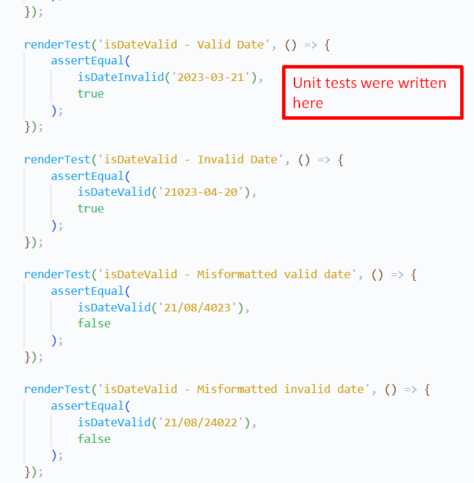

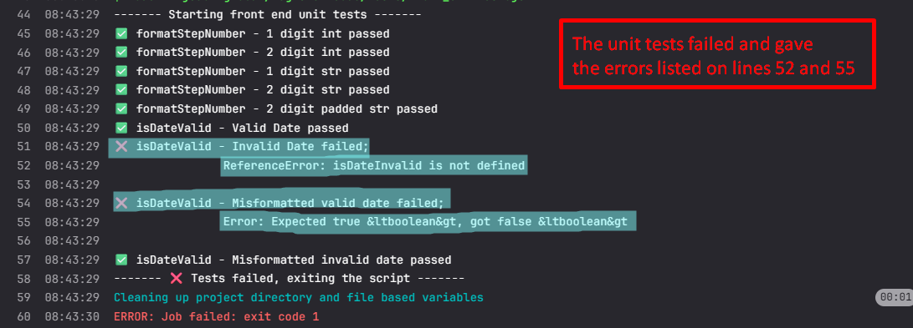

 

 

 

---

**Test Case ID:** 002

**Evidence Attachment:**
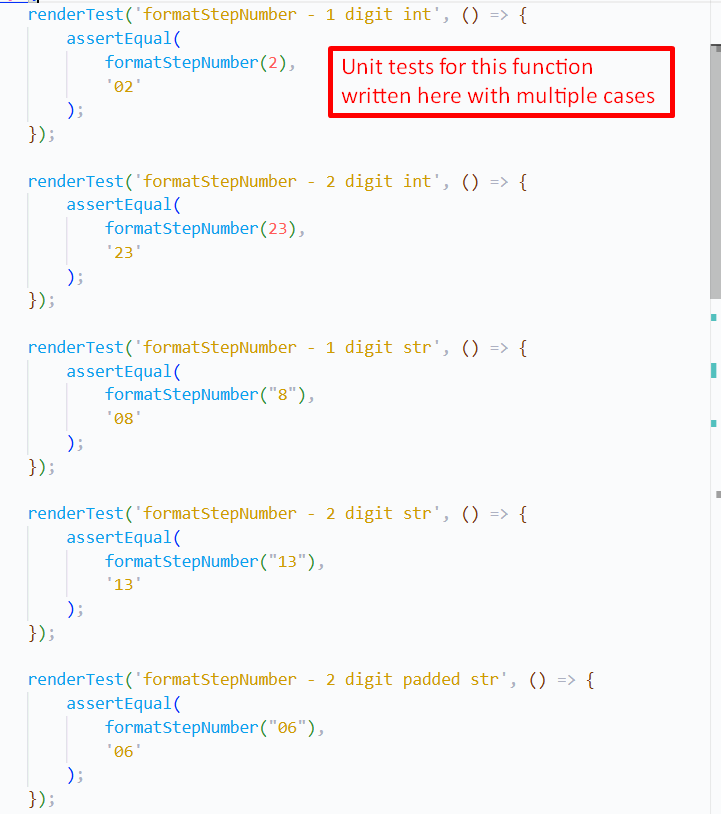

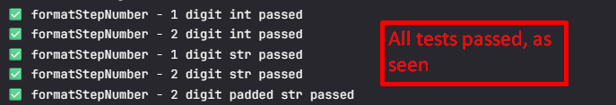

 

 

 

---

**Test Case ID:** 003

**Evidence Attachment:**
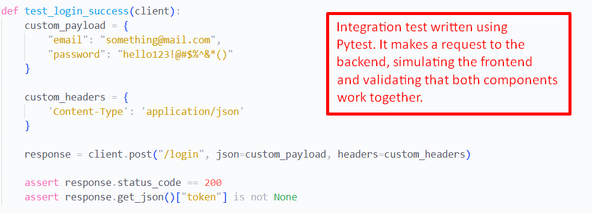

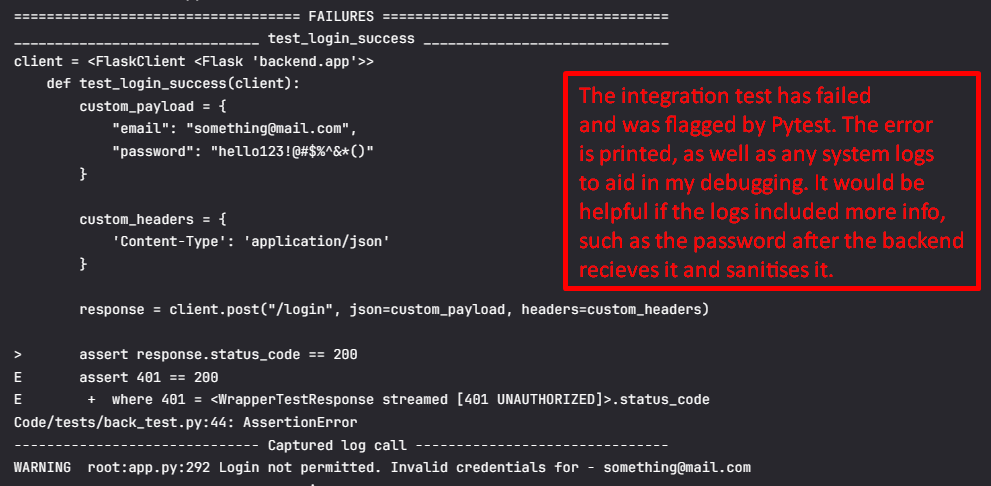

 

 

 

---

**Test Case ID:** 004

 

**Evidence Attachment:**

 

 

 

---

**Test Case ID:** 005

 

**Evidence Attachment:**

 

 

 

---

**Test Case ID:** 006

 

**Evidence Attachment:**

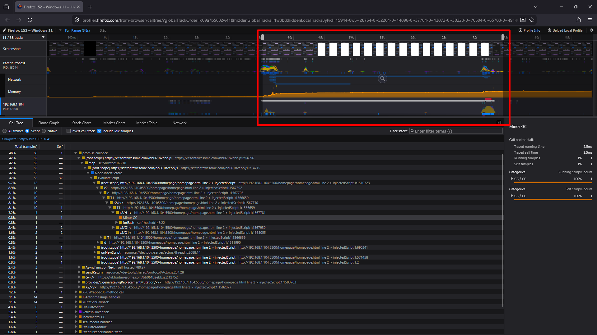

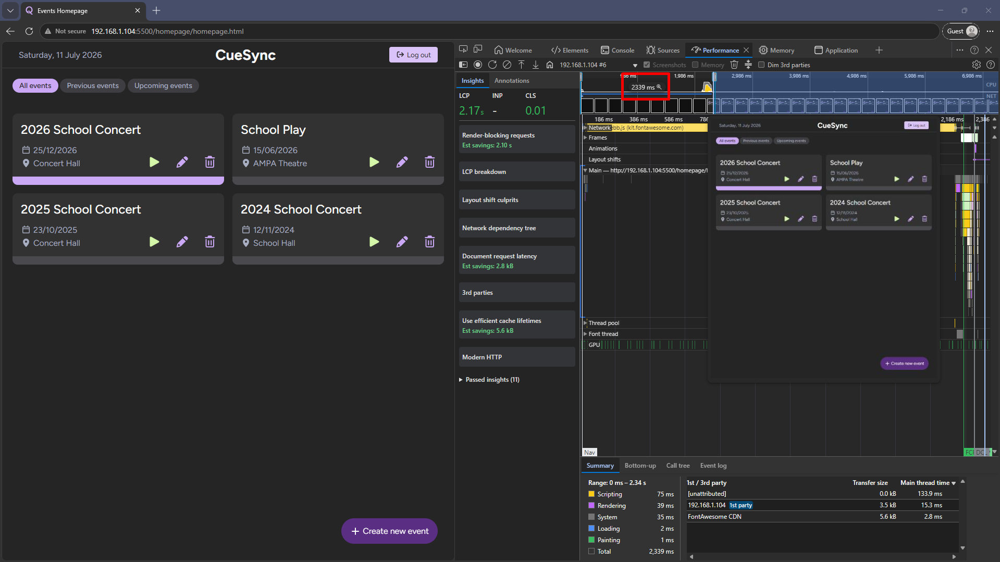

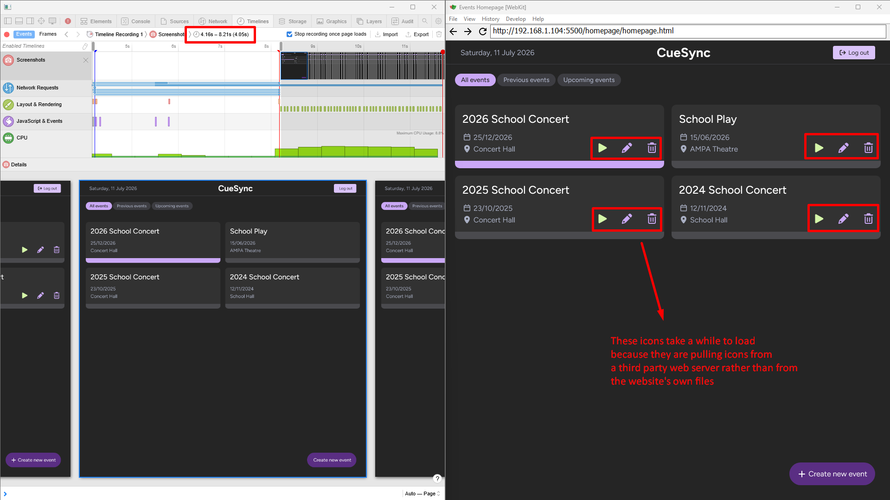

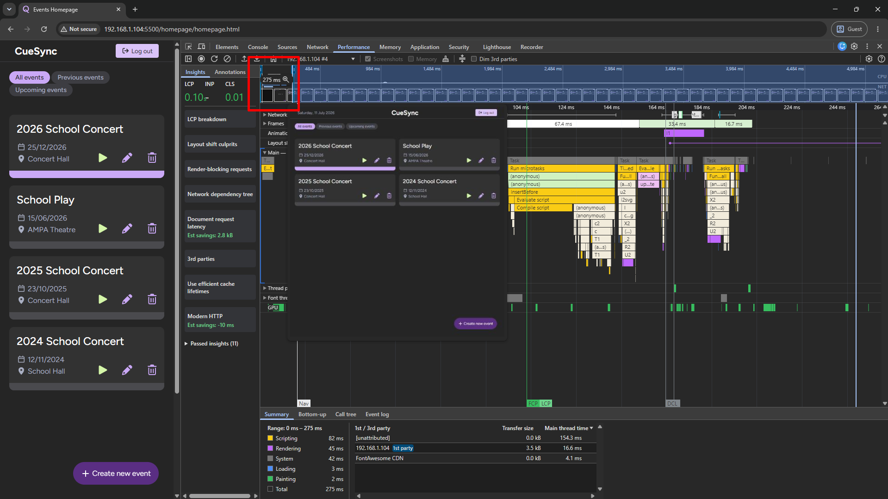

Edit page 

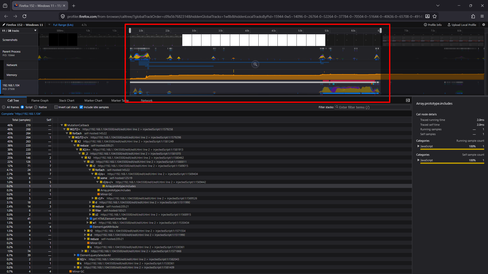

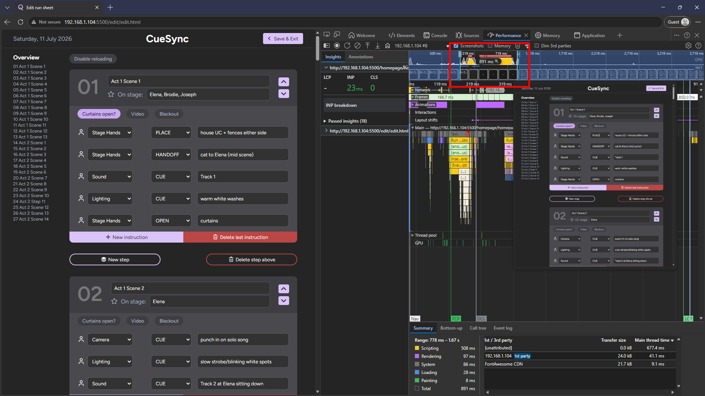

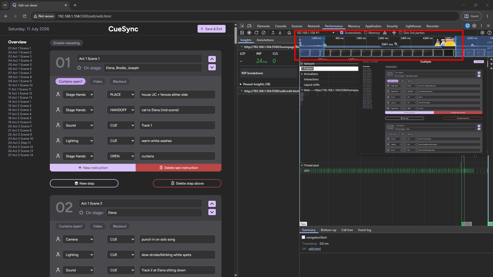

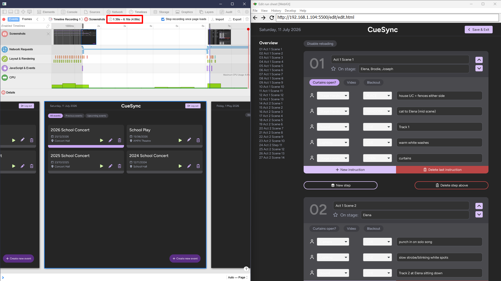

 

 

 

---

**Test Case ID:** 007

 

**Evidence Attachment:**

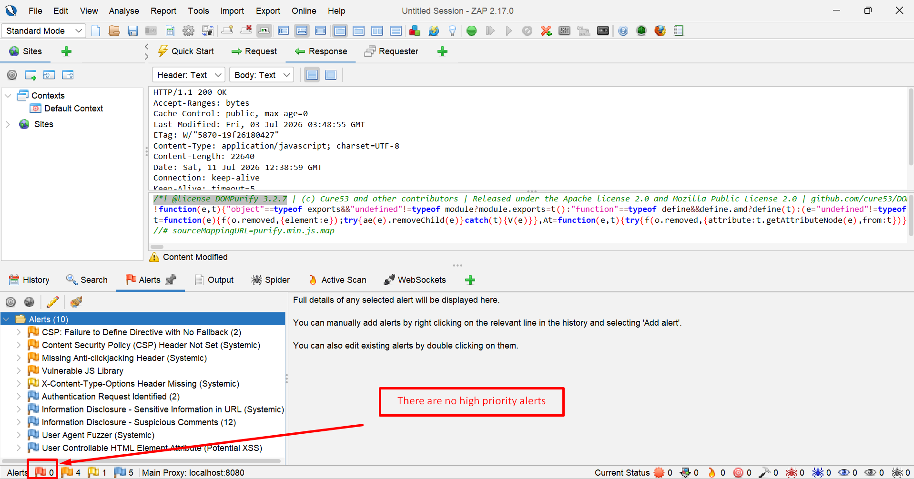

 

 

 

---
