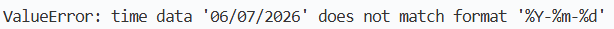

# 5. Bug Tracking & Fixing

**Bug ID:** 001
 

**Description:**
- The unit tests written for `isDateValid()` are returning failed tests
    - Error 1 -> `ReferenceError: isDateInvalid is not defined`
    - Error 2 -> `Error: Expected true &ltboolean&gt, got false &ltboolean&gt`
- The unit tests were not fully updated to the new version of the codebase yet, which lead to failed tests.
- Code review of the `isDateValid()` function revealed that the function itself has no algorithmic or logical flaws

 

**Severity:** 🟢 Low
 

**Status:** CLOSED
 

**Fix Details:**
- Change the unit test to call the correct function instead of the old function
- Change the expected value for the unit test from true to false because it was defined incorrectly

 

 

 

---

**Bug ID:** 002
 

**Description:** 
- One of the integration tests are returning a failure, which is case ii. (A valid user can log in)
- Users are no longer able to log in after updating the deprecated Bleach library to the newer nh3 library
    - The Bleach library "is no longer maintained" - it will not recieve future security updates
- This means that the correct email and correct password returns a failed authentication attempt

 

**Severity:** 🟡 Medium

**Status:** OPEN

**Fix Details:**
- Restored authentication functionality by reinstating the Bleach library and restoring to the previous version of the codebase
- This bug will remain open because the codebase will need to be migrated to an adequately maintained library in the future

 

 

 

---

**Bug ID:** 003
 

**Description:** 
- When instruction details are empty, the command is not saved
- For example, when you create a new instruction with the command "REMOVE" but forget to put in details, the command will default to "HANDOFF"
- Log Warning Recieved: `2026-07-11 18:40 - ERROR - Index error occurred when processing instruction in get_edit_event_data. Possible empty instruction.`

 

**Severity:** 🟢 Low

**Status:** CLOSED

**Fix Details:**
- Found the exact try except block where the error message was coming from
- Found a syntax error - I forgot to define a parameter for Python's inbuilt `.split()` function (lines 427, 428 of app.py)
- For example, I changed `i_command = i_text.split(maxsplit=1)[0]` to `i_command = i_text.split(" ", maxsplit=1)[0]`, and every other instance of this function

 

 

 

---

**Bug ID:** 004
 

**Description:** 
- Functional tests on Safari revealed that when users are creating an event, the date picker does not show. Therefore, there is no data validation to ensure that the date is in the correct format
- When incorrectly formatted dates were sent to the backend, it caused the backend to crash, returning the error below
- Consequently, browsers could not load events on the admin homepage properly. It stops other users from being able to access the event pool.

 

**Severity:** 🔴 High

**Status:** CLOSED

**Fix Details:**
- Applied data validation on the date field, with an error message for users
- Data validation for the date has also been added to the backend to ensure no errors occur in the future
- This should prevent any date format errors

 

 

 

---

**Bug ID:** 005
 

**Description:** 
- The admin homepage and edit event homepage take a long time to load, taking about 4-5 seconds on average between browsers
- The Chrome DevTools "Lighthouse" report reveals that retrieving icons from FontAwesome is the largest contributor to load times
- Retrieving the Figtree font from Google Fonts is also a large contributor to load times

 

**Severity:** 🟡 Medium

**Status:** CLOSED

**Fix Details:**
- Removed any requests made to external servers for any website assets
- Added the neccessary assets into the website's files: FontAwesome's JavaScript files and the font file for the Figtree font
- Load times are now extremely satisfactory

 

 

 

---

**Bug ID:** 006
 

**Description:** 
- After running an OWASP ZAP security test, it detected a vulnerable JS library
- The DOMPurify library is outdated, running on version 3.2.7, while the latest version is 3.4.12

 

**Severity:** 🟡 Medium

**Status:** CLOSED

**Fix Details:**
- Downloaded the latest version of the DOMPurify library from its [GitHub](https://github.com/cure53/DOMPurify/releases/tag/3.4.12) and placed it in the website's files

 

 

 

---

**Bug ID:** 007
 

**Description:** 
- The contrast ratio between the text and the background of some UI elements are not high enough
    - The "On stage" text has a ratio of 4.46:1, lower than the expected 4.5:1
    - The "Next Step" text and button has a ratio of 3.94:1, lower than the expected 4.5:1

 

**Severity:** 🟢 Low

**Status:** CLOSED

**Fix Details:**
- Changed the colours slightly in order to maintain an acceptable contrast ratio, improving web accessibility
