# Project Journal
This will summmarise what you have done in relation to the project, and in particular the problems you encountered and how you dealt with them.

With each entry, also include:
- [ ] Date
- [ ] Any communications you had with others concerning the project
- [ ] Any other thoughts or ideas that you had concerning the project
- [ ] Screenshots

**1. Aims**

- Goals for the week. Specific tasks, features or research topics.

Example: 
*“This week I aim to complete user authentication and set up the database schema.”*

- Add justification for why these tasks matter. Include a link to your project requirements or next steps if possible.

Example: 
*“Authentication is essential before I can personalise the dashboard.”*

**2. Progress**

Describe what you actually did, focusing on thinking, not just doing:
- Key tasks completed
- Code or design decisions made
- New concepts learned. (Include Evidence i.e. screenshots or snippets)

**3. Challenges and Solutions**

Describe problems, bugs, or blockers you faced. Explain how you diagnosed the issue (debugging, console logs, reading errors)

List resources used to help solve the problem:
- Online Resources (GitHub, StackOverflow, YouTube etc..)
- Course Notes
- ChatGPT Assistance 
- Collaboration with Peers or Teacher Assistance
Summarise the final solution and why you chose it.

**4. Reflection**
- What went well this week?
- What didn’t go well?
- What would you do differently next time?
- What skills or knowledge improved?

Example:
*“I underestimated how long building authentication would take. Next week I will break tasks into smaller items and estimate time more realistically.”*

 **5. Aims for Next Week** 

Briefly end each entry by listing:
- Priorities for the next stage of development
- Parts that need more follow-up

Example:
*“Next week I will be focussing on the Quality Assurance Document and adding lazy loading to my project.”*

## 22/03/2026
**Aims:**
I aim to get a start on the SEP by setting the foundation for documentation structure. This will save time in the long run, so I don't have to worry about documentation formatting.

**Progress:**
Downloaded and read the project notification, and created the structure of the ePortfolio. Also set up the neccessary software (GitHub Desktop) and links between GitLab and VSCode. I also started the project journal.

**Challenges and solutions:**
There were no challenges faced with creating the structure of the ePortfolio.

**Reflection:**
I aimed to set up the structure of the documentation so that I do not have to worry about it later on in the project.

**Aims for next week:**
Starting on the project itself by generating potential ideas and scenarios.

## 08/04/2026
**Aims:** Brainstorm some ideas and scenarios using a mindmap.

**Progress:**
Created a set of GitLab commit conventions to adhere to, ensuring consistency and allowing the commit history to be more accessible. Every commit from now on will follow the [conventional commits specification](https://www.conventionalcommits.org/en/v1.0.0/).
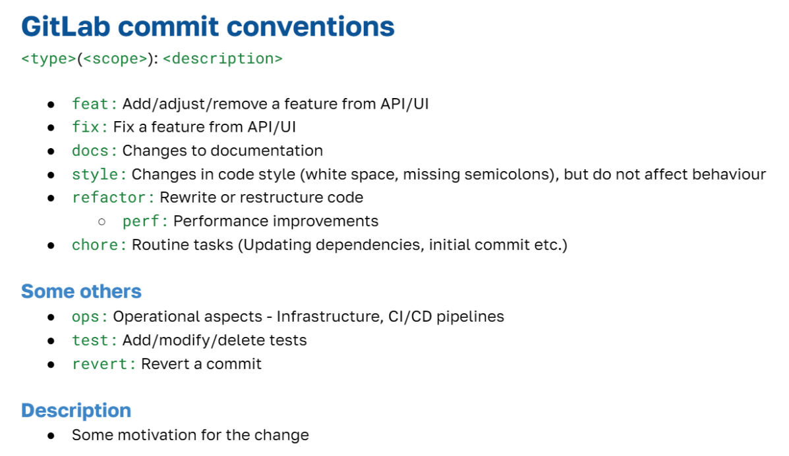

Added files from the project template into my own documentation to give myself starting points for when I commence future phases of the project.

Made a mindmap to brainstorm potential ideas and technical requirements:
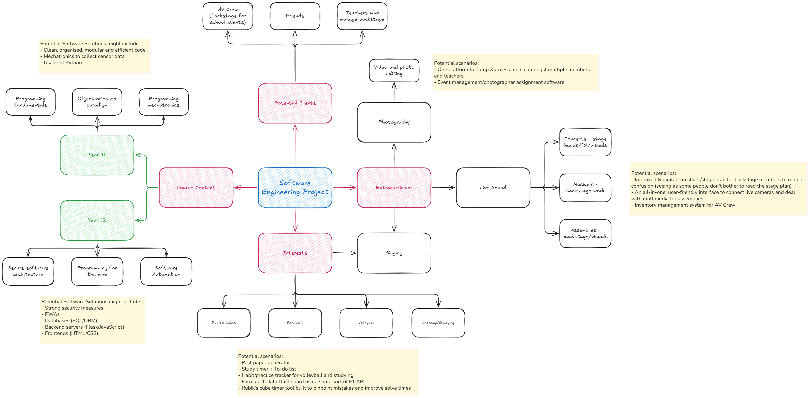

I also created my detailed scenario this week, taking inspiration from my own experience helping out backstage during a concert. I wanted to ground the project in something I knew well, which makes it easier to create software requirements.

**Challenges and solutions:**
Was signed into multiple accounts on VSCode, which lead to wrongly authored commits. This was fixed by removing unneccesary accounts and modifying commit history to indicate the correct author.

I fixed this by using [this article](https://www.git-tower.com/learn/git/faq/change-author-name-email), which walked me through interactive rebasing to edit the author of the previous commits.

**Reflection:**
I successfully familiarsed myself with markdown this week, but I didn't think that brainstorming ideas would take so long. Next week, I have to keep my writing concise.

**Aims for next week:**
Develop a project proposal and hopefully start the research & planning phase.

## 15/04/2026
**Aims:**
This week, I aim to finish the Identifying and Defining phase and start work on the Research and Planning phase.

**Progress:**
This week I worked through my project proposal and the I&D phase. I currently have worries about how feasible this project is, especially with the given time frame. There is some room in the scenario to further reduce the amount of essential features (e.g. No synchronised run sheet). I also explored [GitHub flavoured markdown](https://docs.github.com/en/get-started/writing-on-github/working-with-advanced-formatting/organizing-information-with-collapsed-sections) to find new ways to format project documentation, like the collapsable text below.

Possible entities involved in the project

I also listed all the entities that will be represented in the software (thus starting the R&P phase):
- Events as an object from an event class
- Users as an array of records or a database
- Run sheet steps as an array of objects
    - Each step would be an object with: step number (integer), step instruction (string), performance title (string), assigned role (string), notes (string)

**Challenges and solutions:**
The project notification and the course work have varying instructions. I had to consolidate them such that all dot points were being discussed. I may have to reorganise my I&D phase later on, but I know that all of the required information is in there.

**Reflection:**
I believe I still need to cut down the amount I write for future phases, but I will have to check with my teachers. I have fleshed out my scenario, which will serve as the foundation for the rest of the project. I am glad that I grounded the scenario in something I know and have experience in - 3 years of live sound/backstage inspired this project. 

Writing rough plans for what I am going to write in my documentation also significantly helps and reduces the effort required to sit down and write documentation.

**Aims for next week:**
Start work on the researching and planning phase.

## 20/04/2026
**Aims:**
- Meet with teachers to clarify project
- Continue R&D and get as much done as possible before other assessments start. This would also give more time for producing & implementing.
    - Write documentation for determining software development approach. This has to be done so I can determine how my GANTT chart should be structured.

**Progress:**
- Had a web lesson with teachers which motivated the following:
    - Restructured and organised I&D documentation to make it easier for third parties to read. Those unfamiliar with live sound/production would struggle to grasp the context for the project.
    - Assessed the scheduling feasibility of the project, with help from teachers. Created some backup options as a result:
        - Crew members could press 'next' on their own, rather than having it synchronised
        - Remove ability to edit run sheets *during* an event
- Client suggested to display the time before a certain step. From my experience making the Learner Hours PWA, date and time calculations can get messy if done without using in-built features (such as JavaScript's `Date()` object). This is why I added this as an optional feature to add last.
- GANTT chart was made and I am well into the research and planning phase.
    - The timeline may seem unrealistic at first glance, but I tried to take into account the previous phases of the project, and how it would speed up development. For example, event administrator home page would take less than a week since I already would have made UI components.
    - Some events are also quite long, since I try to take my exam dates into account. I also tried to condense development a bit, since I am involved in backstage productions for a musical on 14th June. I am hoping I can trial run the software there. 
    - There is ongoing client feedback, which is a characteristic of the Agile approach
    - The chart is the absolute ideal, and I have 1-2 weeks spare to account for unforeseen problems.
- Created comparison table to effectively choose an appropriate software development approach using this [Portable.com.au article](https://portable.com.au/articles/waterfall-agile-wagile-project-methodology-decision) and [Atlassian article](https://www.atlassian.com/agile/project-management/project-management-intro)

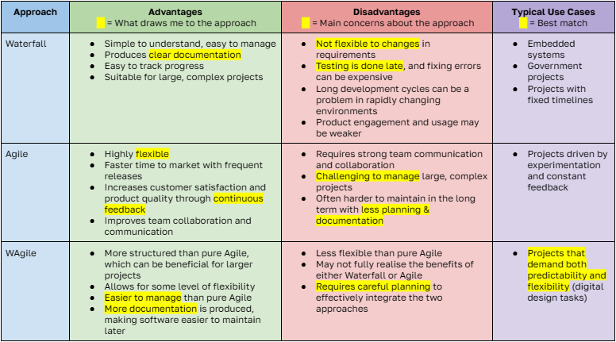

- Found existing solutions to the problem.
    - [Lasso Rundown](https://www.lasso.io/rundown/) provides a version of my software with some extended features, but it is unclear if it can synchronise across multiple devices *during* an event. It looks like it uses strict times (e.g. 9:15:23AM), which is not ideal in my unpredictable environment.
    - [QLab recital](https://qlab.app/cookbook/qlab-recital/) is exactly what I am looking for, but it is used on macOS. It can synchronise across multiple devices, but the UI for crew members isn't visually appealing and the event creation process can be confusing.
- When filling out [client communication](./02%20-%20Research%20and%20planning/4.%20Client%20Communication.md), I reflected on which communication issues in Set 17.06 might be applicable. Since I've known both of my clients for a couple years, I concluded that all issues could apply, and it was up to me to mitigate those issues.

**Challenges and solutions:**
- Client had trouble grasping the concept of the project, even after some discussion. I created a rough design of the UI using Figma to visualise the software solution and make it easier to understand

Rough UI designs

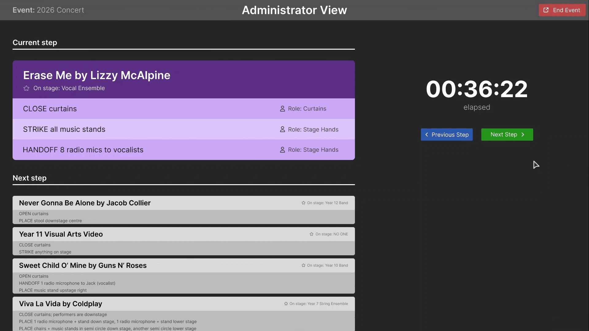
*Event administrators can progress through the run sheet*

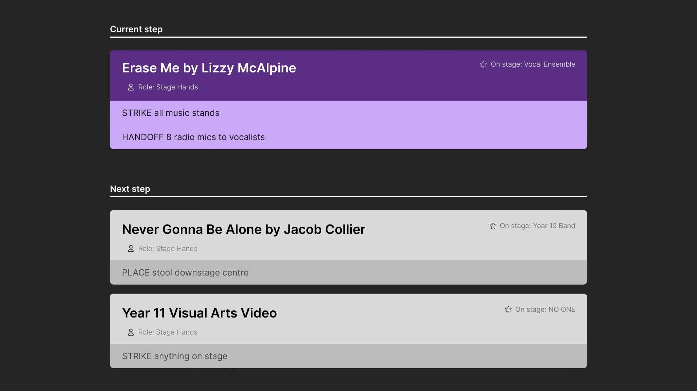
*Crew members can view instructions, synchronised with the event admin*

- Due to the course conflicting with the task instructions, I had already specified methods for communication with stakeholders at an earlier stage. I kept this in my GANTT chart to accurately reflect what I had already done. I decided to extend the methods using the information in Set 17.06

**Reflection:**
I am really happy after making the GANTT chart because it started to provide some structure to the project. I know exactly what I need to work on, and on what day. It definitely helped that I created a Kanban board using the tasks on the GANTT chart.

I am also getting more proficient at GitHub flavoured markdown. I don't need to search up how to format text as often, and I am starting to incorporate more advanced (and more useful) markdown features like footnotes.

**Aims for next week:**
I aim to work on the Quality Assurance document. I want to finish it so that I can keep in time with my GANTT chart and allow more time for producing and implementing.

## 27/04/2026
**Aims:**
This week I want to finish my Quality Assurance document and ideally, finish the Research & Planning phase so I can have a bit more development time.

**Progress:**
- Completed the QA checklist. I am currently relying on my functional requirements as my source of truth.
- Researched security libraries that are available for Python.
- Found this [article](https://alexwlchan.net/2023/testing-javascript-without-a-framework/) that may be helpful for writing unit tests in JavaScript.
- Completed data dictionaries and systems modelling

**Challenges and solutions:**
- Researched options to deploy the application. The good free option for a Flask app is [render.com](https://render.com), but has some limitations. Data does not save and the server reduces in performance after 15 minutes of no activity, so I have decided not to deploy it publically. I will instead opt to host the app locally, and users can connect to the app (for now).
- Client suggested a new feature: crew members should be able to relay to other crew members as to what microphone number is being used. This would be relayed in real-time during an event. I discussed that it would not be feasible in the time frame, but I plan to add it as a 'innovative solution' in my documentation.
- Data dictionaries were hard to start without being able to visualise the database. I created database schema to aid in creation of data dictionaries, but it revealed problems in my planned database. To fix these problems, I made the schema online to make it easier to modify.
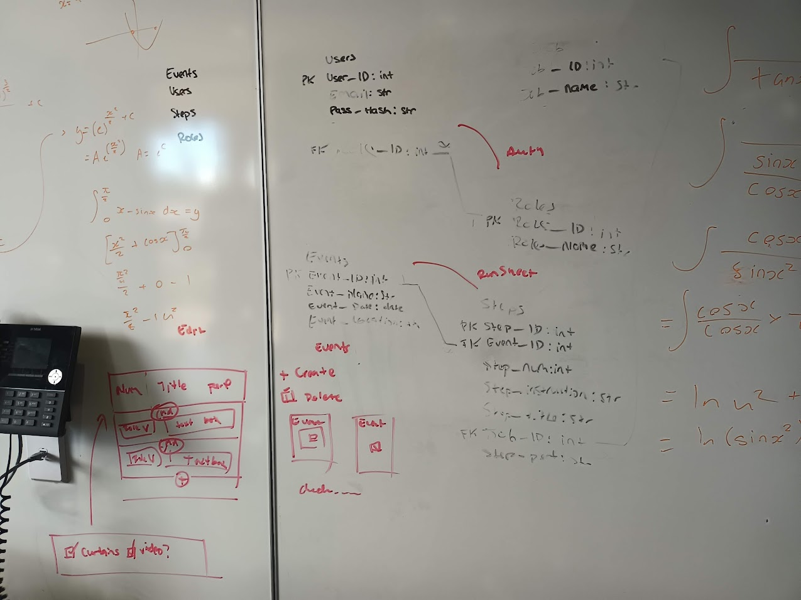
- Completed storyboard using Figma, inspired by some Pinterest posts. Overhauled the UI/UX according to client feedback/my own testing. It was hard to read the previous UI in the dark.

**Reflection:**
The QA checklist seemed daunting at first, but I'm happy that I managed to finish it in the week. As of now, I am still on time with my GANTT chart, which quite frankly, is a miracle. I have been trying to get as much done as possible before exams hit and I might need to modify the GANTT chart in the future.

**Aims for next week:**
According to my GANTT chart, I should be starting on Producing and Implementing next week. This gives me extra time for development, which many students wish they had done last year (learnt after meeting teachers in web lesson)

## 04/05/2026
**Aims:**
I am to create flow chart algorithms since I am required to do so. I want to do this before development so that everything is planned out, and so I can focus entirely on development later on.

I also want to utilise proper branching strategies this week, setting it up so I don't have to worry about it while producing. You can see that I have pretty much only been using one branch: 

Image of repository graph

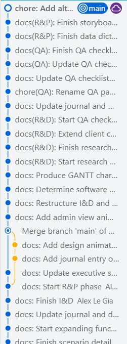

**Progress:**
- Set up a programmed data backup as per Set 18.06, using Windows Backup (Available on Windows 11) so that I didn't lose my data at any point.
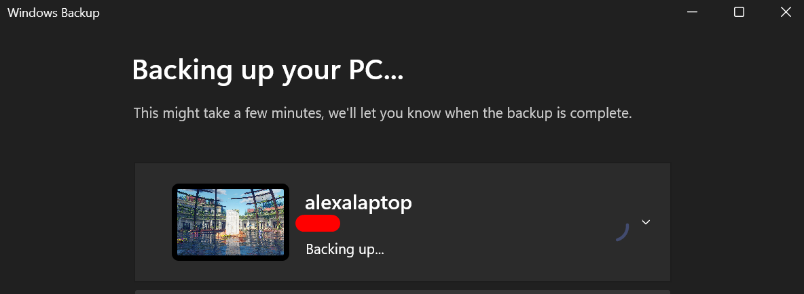
- I only made flow chart diagrams for the live view interfaces, since this is the unique part of my project. I wanted to flesh the system logic out before I made it to reduce the amount of bugs, making it easier for me in the long run. I had to make a table to draft out my first flowchart - once I did that, it was easier to make my second one.
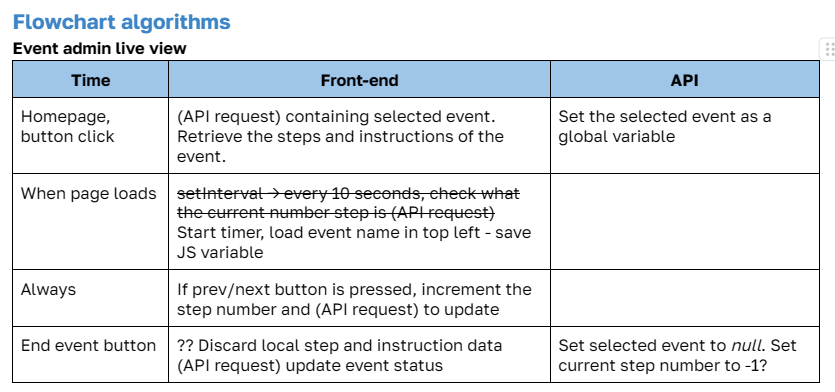
- I wanted to revise my branching strategy to fulfil the QA requirements and maintain organisation. I used this amazing [article](https://dev.to/karmpatel/git-branching-strategies-a-comprehensive-guide-24kh) which summarises popular branching strategies. I chose the "GitFlow" branching strategy, but removed the role of a `release/*` and `hotfix/*` branch since I do not anticipate this being used.
- I watched some YouTube videos on how to make a Python virtual environment - an isolated environment to prevent package version conflicts and make the project easier to share ([W3Schools](https://www.w3schools.com/python/python_virtualenv.asp)). I wanted to make sure that my app worked on all platforms.
- I had to brush up on my SQL skills and learnt how to create new tables in SQL syntax with this [article](https://www.w3schools.com/sql/sql_create_table.asp), which was neccessary for my project.
- From my past experience making the Learner Hours PWA, CSS can be unpredictable at times. I viewed a few [articles](https://www.joshwcomeau.com/css/custom-css-reset/) that discussed their own methods of resetting CSS, and I decided to take some code snippets. Hopefully this will speed up development and make it even easier.
- Transferred UI designs in the storyboard into HTML/CSS/JS code

**Challenges and solutions:**
- I encountered this error when creating the `init_db.py` file to create the database. I didn't know what this meant, so I looked at some StackOverflow articles and did a Google search. The search summary told me that I had a misplaced foreign key definition, so I moved all my foreign key definitions at the bottom and it solved the problem. 
 
Screenshots of error and Google search results

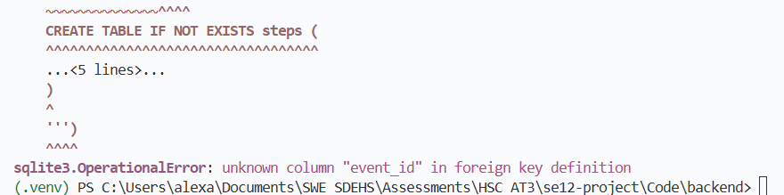
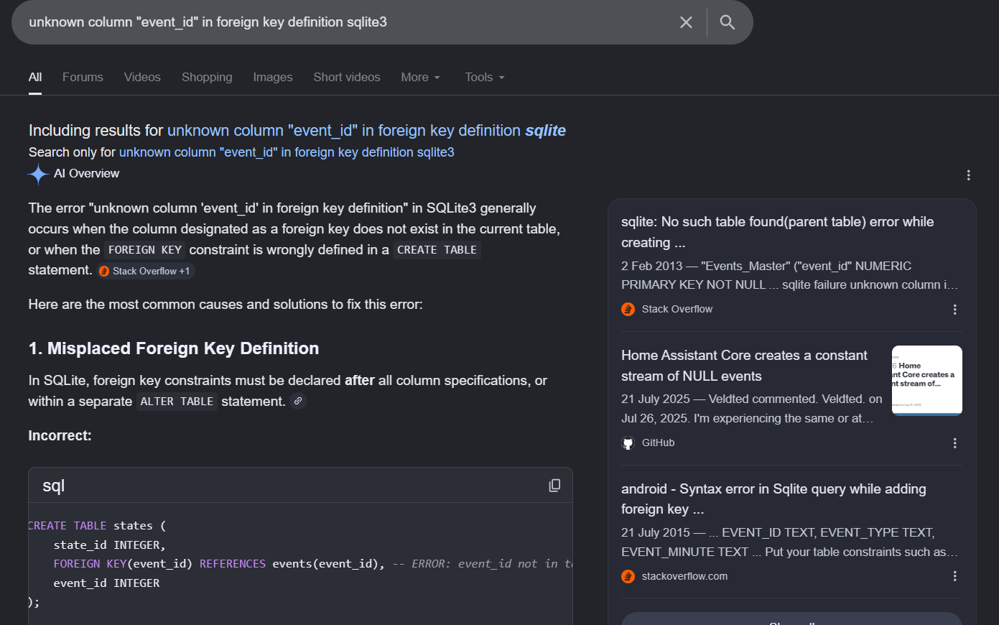

- With the flowcharts under my review column, I realised that they were a nightmare to read. With the draw.io file that was saved on my laptop, I decided to clean up the logic of the flowchart. It is now much more readable, giving me a better blueprint to follow while producing and implementing. 
 
Image of previous flowcharts

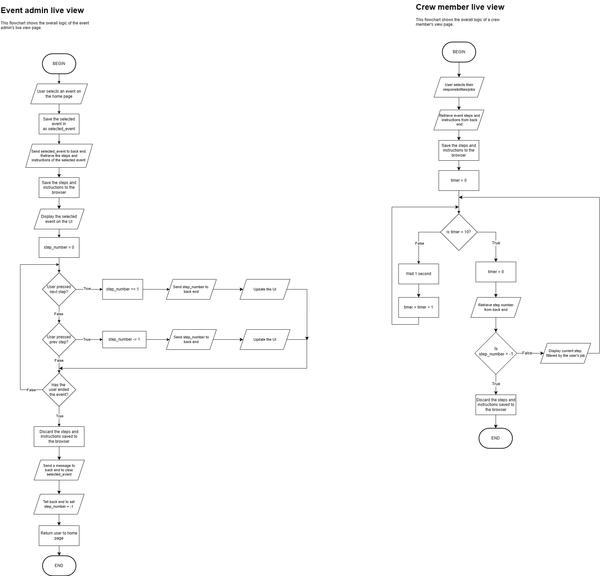

**Reflection:**
- This week went extremely well. I started making the UI in HTML/CSS/JS, and it was a faster process than I thought, especially because I had UI designs and colours planned out in my storyboard. At times, I encountered JavaScript bugs too small to document, but they were caused by small syntax errors which was time consuming to manually find and fix. Next week, I should utilise JSLint more, which will automatically point out errors in my code.

GANTT chart update

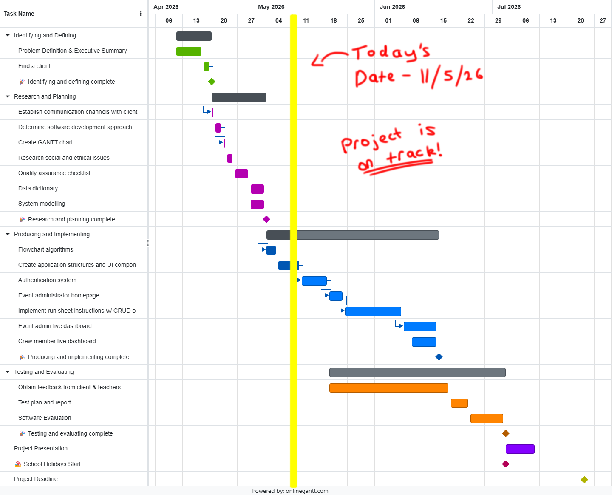

**Aims for next week:**
- Finish off creation of UI components and start building authentication system

## 11/05/2026
**Aims:**
- Finish of creation of UI components
- Start building authentication system

**Progress:**
- I watched some [YouTube tutorials](https://www.youtube.com/watch?v=-uyI0TjhXdk) and looked through some [StackOverflow articles](https://stackoverflow.com/questions/50404970/web-components-pass-data-to-and-from) in order to learn how to build web components - which allows for customised, reusable components that allow for consistent design. I implemented this into my project.
- I also used a variety of W3Schools articles and MDN web documentation to help me design UI components based off of my storyboard. The discovery of CSS grids from my LearnerHours PWA has seriously been life changing - it offers a flexible and intuitive way to arrange content in grids.
- Learnt and added automatic testing to project, which runs every time a commit is made to the main branch, but not the other branches.

**Challenges and solutions:**
- I had a problem where the app could not read the properties of an undefined objects while working on the `getSTEPJSON()` function. I first searched this up on Google, which pointed me to a few StackOverflow articles which suggested that a variable was not assigned yet, but I was still confused. I then asked Gemini for some assistance on how to solve this issue, and it pointed out a scope error. I was using an ordinary function, which creates its own scope, but I should have used an arrow function. This allows me to still access objects using `this.` in JavaScript, which I needed for my function. I did not know that I had to do this, since I am new with web components.
- While making the UI components, I realised that allowing event admins to edit events while it is being played could be quite complicated to implement. To combat this, I tried brainstorming different approaches to structuring my backend. I ultimately decided to remove it from my functional requirements in order to increase the likelihood of success for my project.
- I was wondering why my repository graph did not properly show my utilisation of branching, but after some of my own testing, I found out it was because I was working on branches in isolation with one another. For instance, I would commit on one branch, then commit on another branch, but never work on two branches at the same time, which is why my graph might not look how I expected. In researching the Git commands, I gained a better understanding of how git works, including how merging works, what merge commits and how the repository graph is built.
- I did not know how to properly create a YAML file for GitLab - I learnt the syntax from a couple of articles and I knew I needed this to create pipelines since I had done it at a smaller scale before. It would allow me to automatically run my tests upon every commit. I looked at some [Medium articles](https://medium.com/@morepravin1989/automatically-run-tests-using-github-actions-step-by-step-guide-for-beginners-with-example-51acdd6dd0ea), which were helpful, but wasn't specific to my project. Still needing help, I asked Gemini what to write in the YAML file and it told me to install jsdom, which would allow Gitlab to automatically run.

**Reflection:**
- This week I had some troubles with using version control effectively, since I couldn't visualise branches being merged in the terminal. This caused me some stress I'd like to avoid, so I will use the UI in VSCode in the future.

**Aims for next week:**
- Since I didn't start on the authentication system, I am to do that next week.

## 18/05/2026
**Aims:**
- Make an active effort to reduce the amount written in diary entries in order to keep it succint and readable
- Finish authentication system, which I need to do first because it serves as the foundation for the rest of the pages (crew/admin dashboards)
- If time allows, start work on the event admin dashboard

**Progress:**
- Inspired by the musical production I am currently involved in, I decided to name the app "QueSync". This is because the actions for backstage crew are organised into "cues" - key points and pieces of dialogue that serve as cues to prepare equipment and props. Also, I found the letter Q to be more appealing as an icon than C.
- After viewing a few articles about the implementation of an authentication system in a Flask app, I was able to understand its authentication logic in the context of a backend API. I gathered two main methods for achieving this - issuing and checking JWTs, or using the Flask-User library. I found examples in PWP6 of a secure API, and adapted the code for my own project. This method uses JWTs for session management. I decided to authenticate users by taking user inputs, sanitising it and checking the database via safe SQL queries.
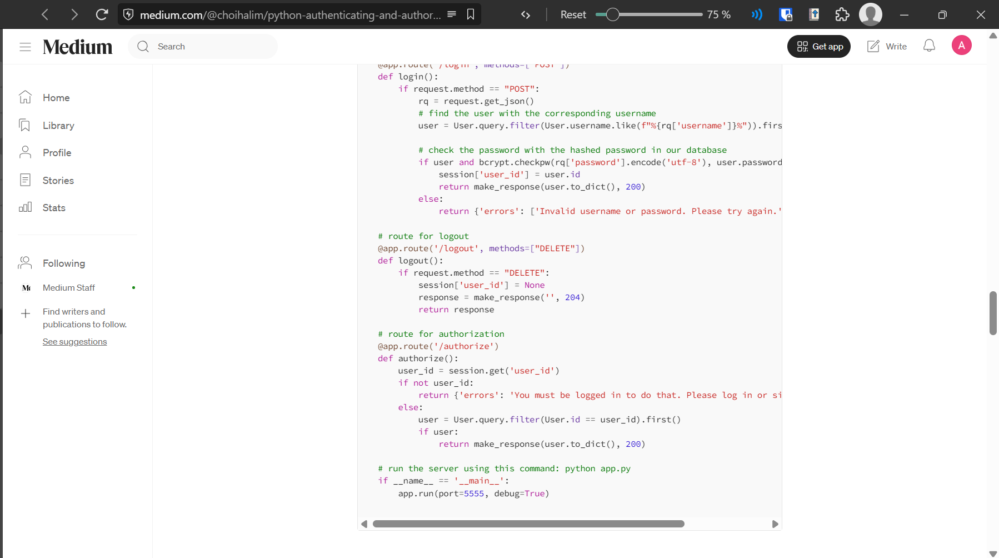

**Challenges and solutions:**
- Towards the end of this sprint, I reached out to my client in order to test the authentication system. I observed that they had no issues with navigating the UI. However, I ran into some connection issues. Initially, the client could view the front end page, but it could not access the backend server. After looking through my code and their console logs, this was because the code for my front end was pointing to `http://127.0.0.1:5000`, which leads to the device's own local host. I had to change this to my public facing IP address in order to resolve the issue.
- Upon completion of the authentication system, I merged the feature branch with the main branch. My pipelines to perform unit/integration testing on the backend [failed](https://gitlab.com/alexander.legia1/se12-project/-/jobs/14461597871). Reading the error logs (pictured below), I saw that the testing script was missing a module. I watched a video on setting up GitLab pipelines for a Flask project, and learnt that I needed to include a command to install all the requirements. I did that, and it fixed the problem.
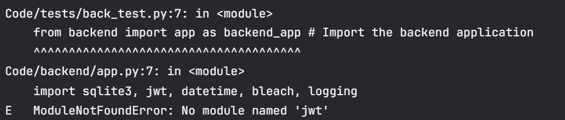

**Reflection:**
- This week went quite smoothly, as I was able to adapt UI elements from my LearnerHours PWA and backend elements from coursework
- Other assessments have definitely impacted how frequently I work on the project. Next week, I will only work on the project in extremely small tasks/chunks. This will allow me to make time for my other assessments, while still working on the project.

**Aims for next week:**
- Start work on the homepage for the event administrator. There is no necessity to finish it since I have important exams in the following weeks.

## 25/05/2026
**Aims:**
- This week, I want to start work on the homepage for the event administrator, which is crucial for the next step in my GANTT chart
- I will write a diary entry at the end of the week, instead of throughout the week. This will force me to be concise.

**Progress:**
- Since I had already created all the UI components, making the interface was quickly done.
- Added functionality to the homepage: pulling events from the backend, creating events, deleting events. I used my previous experience gained when making the LearnerHours PWA app to make the JavaScript for the page.
- I am starting to get the hang of how backend servers work. While doing some research, I found that I had coded my backend as a REST API, which sends a representation of the necessary data, rather than the entire database.

**Challenges and solutions:**
- In the backend, I wanted to return all my events in chronological order so that events in the future would come first. I didn't know how to do this, so I looked at this [StackOverflow article](https://stackoverflow.com/questions/35437516/python-sort-list-of-json-by-mm-dd-yyyy-dates) and used this code to do so. I implemented it in my backend and only had to change some parameters.

**Reflection:**
- It seems that making a reflection at the end of the week worked - this week's diary entry is noticably more concise. I will continue to do this.
- This week was marked with an important assessment, so I did not get much project work done.

**Aims for next week:**
- Start the next phase of my project: implementing CRUD operations for run sheet steps

## 01/06/2026
Empty entry. No work was completed. Reflection on this period can be accessed [here](#15062026).

## 08/06/2026
Empty entry. No work was completed. Reflection on this period can be accessed [here](#15062026).

## 15/06/2026
**Aims:**
- Start implementing CRUD (create, read, update, delete) operations for run sheet steps because it is the next phase of my project
- I have no expectation to finish this feature this week because I expect that it will be the most time consuming feature

**Progress:**
- Created the UI for event admins editing an event but did not add functionality. Since I had already created UI components earlier, I just had to put them together.

**Challenges and solutions:**
- I realised that once you are editing an event, you can create steps, but not delete them. I wish I saw this problem in the Planning phase so that I could make it earlier and waste less time. I also realise that using WAgile allows me to adapt my Producing and Implementing phase as needed - using pure Waterfall would be utterly horrendous and lead to unfulfilled project requirement/quality assurance tests.
- One glaring challenge is that my project is not running on schedule according to my GANTT chart. I know that I will not be able to catch up on this, judging from experience on previous projects. After some deliberation, I determined that I would try my best to get back on schedule.

**Reflection:**
- The past two weeks have been extremely busy with other assessments and events happening at the same time. No project work was done. Next time, I would still allocate a bit of time to project work during busy phases to avoid losing familiarity with the project.
- I implemented this advice and allocated a bit of time to the project this week and I believe that it went well. Valuable progress was made, and it did not take too much time at all.

**Aims for next week:**
- Get back into the flow of the project and continue work on creating the page to edit run sheets

## 22/06/2026
**Aims:**
- Work on editing run sheets and implementing CRUD operations. I would like to finish this if possible because I am currently behind according to my GANTT chart.

**Progress:**
- I finished the functionality for the edit page without too many issues. The logic was similar to the homepage, so there were no surprising challenges this time around.

**Challenges and solutions:**
- Last wekk I realised that I was missing a crucial part of the edit page. This was the delete button. Since users couldn't delete steps or instructions, editing events proved to be quite limited. To solve this, I added a delete button to the UI and added its functionality. Referring to my previous code has been the most helpful thing to do by far.

**Reflection:**
- This was quite a productive week and I finished this functionality sooner than I expected. I am still behind schedule according to my GANTT chart, but not as much as before.
- If I were to do this project again, I would take more care in the planning phase so that I don't miss a crucial function. I might talk with clients more in order to ensure this.

**Aims for next week:**
- Finish producing and implementing

## 29/06/2026
**Aims:**
- Finish producing and implementing in order to try and get back on track

**Progress:**
- Made a couple of UI changes to the edit page. The overview on the left side now stays there when the user scrolls down.
- Created the event admin live dashboard. I also used my flowchart algorithms to help.
- Created the crew member live dashboard using similar logic to the edit page and homepage. The design has been changed slightly in order to minimise the extra time spent on producing and implementing. I also used my flowchart algorithms to help.

**Challenges and solutions:**
- I anticipated that I needed to make the stopwatch on the event admin live dashboard using the JavaScript `Date()` object, but I wasn't exactly sure how to. I looked at some articles on how to achieve this, but they used other methods that were quite complex and didn't fit my needs. I stumbled upon some code in [this article](https://dev.to/chrislemus/stopwatch-using-javascript-accurate-and-easy-5ado). I modified it and used it in my project because it fit exactly what I was trying to do.
- I wanted to use global variables in my backend because I needed to store the current step while an event is being played. I tried simply declaring a variable in the global scope, but this didn't work. After some research, some methods to achieve this were recommended to me. I decided to use caching with the help of this [documentation](https://flask-caching.readthedocs.io/en/latest/), because it was the simplest to implement.
- After the core functionality was finished, I performed more system testing using simlated data with my client. I gave them a user account while I operated an administrator account. This returned a CORS error, like [before](#18052026). I went home and tried to debug this issue. After some experimentation I figured out that it was because the URLs of the backend and frontend kept changing. This is because it depends on the network I am connected to. I added config files to make it easier to set up the web app. Installation can be easily done by typing in the frontend and backend URLs.
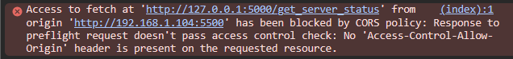

**Reflection:**
- Overall, this week was extremely productive because I've managed to finish a significant chunk of producing and implementing in a couple days. I didn't realise that I would end up reusing a lot of my previously produced logic and algorithms.
- However, being off schedule according to my GANTT chart has been quite a disadvantage, since I am unable to contact teachers for my testing and evaluating phase. I will have to rely on senior crew members.

**Aims for next week:**

---
## DD/MM/YYYY
**Aims:**
**Progress:**
**Challenges and solutions:**
**Reflection:**
**Aims for next week:**