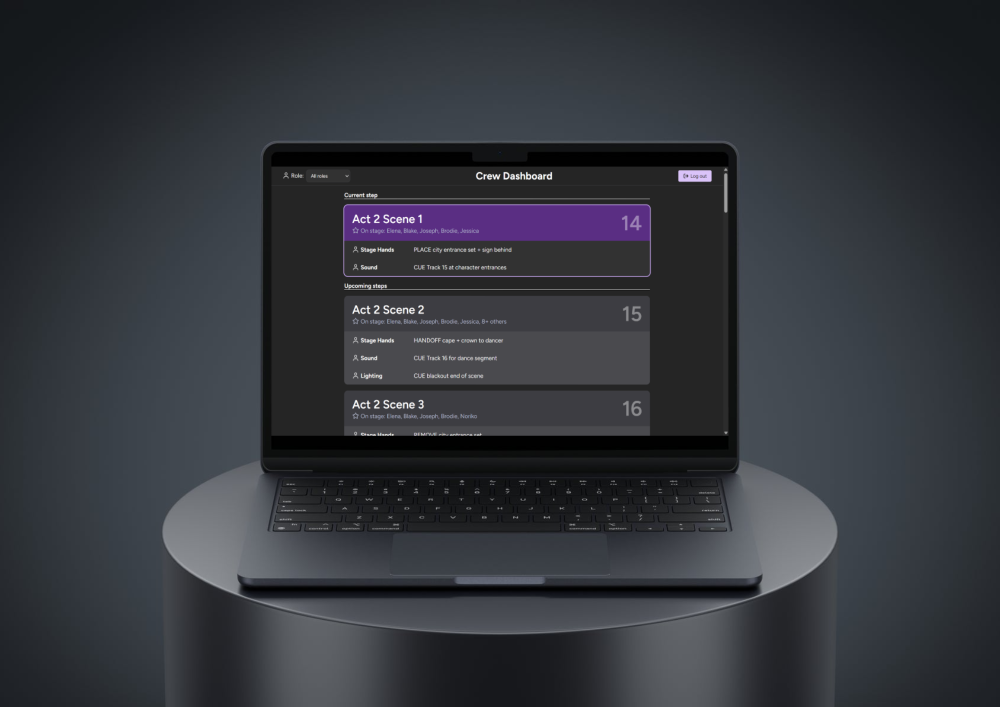

# SE12 Software Engineering Project
**Author:** Alexander Le Gia (NESA Number: 39507552)
 

## Description
**Digital Backstage/Audio Crew Run Sheet**

The software provides a digitized and synchronised run sheet, which highlights the current step and updates during an event. Crew members are able to follow along with the event administrator and easily view their instructions, reducing the amount of incorrect or missed instructions.

## Installation
- Has to run in a development environment (due to project constraints)
- Requires:
    - Live Server VSCode extension (should be running port 5500) (set root directory to `Code/frontend` if not set already)
    - Python 3.14.3
    - Must run `pip install -r requirements.txt` 

### Using the application
#### Configuration
1. Find out your device's IPv4 address. This is normally something starting like 192.168.#.# or 10.#.#.#
2. Navigate to `Code/frontend/config.json` and type in your device's IPv4 address in the "backend_url" property
3. Navigate to `Code/backend/config.json` to change the frontend url. Do not change this unless the application is not working properly. The backend will automatically allow any frontend clients to make requests.
4. Navigate to `Code/backend/database/database.db`. If this file does not exist, do the following:
    1. Open `Code/backend/init_db.py` and run the Python script

#### Starting the website
1. Navigate to and open `Code/frontend/index.html` within VSCode
2. Click on the "Go Live" button in the bottom right corner to start the Live Server VSCode extension
3. Navigate to and open `Code/backend/app.py`. Run the Python script.
4. Use the website! If you would like to view backend logs, you can navigate to `Code/backend/app.log`

#### Sample Data
You might notice that there is already some data within the system (hopefully). Here is some sample input data for your convenience:

**Log in as admin**
 
Email: amandarin@gmail.com
 
Password: hello123!@#$%^&*()

**Log in as crew member**
 
Email: alofa@toast.com
 
Password: hello123!@#$%^&*()

**Sample Events**
- The 2024, 2025, 2026 School Concerts have been designed to model the system's actual use, albeit at a smaller scale.
- The School Play has been designed to be an extremely large event on purpose.